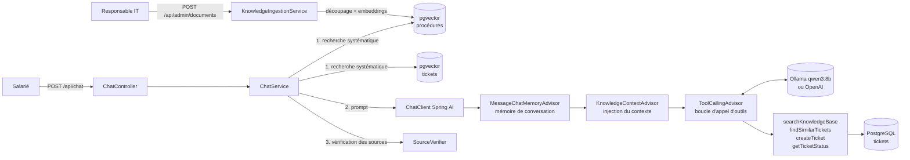

# HelpDesk Agent — Spécifications

> Agent conversationnel de support IT interne, écrit en Java 21 / Spring Boot / Spring AI.
> Un salarié décrit son problème en langage courant ; l'agent cherche une solution dans la base de connaissances et dans les tickets existants, puis répond, ou crée un ticket s'il ne trouve rien.

| | |
|---|---|
| **Statut** | Étapes 1 à 4 terminées |
| **Auteur** | Collins Soares |
| **Dernière mise à jour** | 31/10/2026 |

---

## 1. Contexte et besoin

### 1.1 Problème

Dans une entreprise de taille moyenne, le support IT de niveau 1 reçoit surtout des demandes répétitives : mot de passe expiré, VPN qui ne se connecte pas, imprimante introuvable, accès à un logiciel. Les réponses existent déjà dans des procédures internes ou dans des tickets déjà résolus, mais :

- les salariés ne les trouvent pas (procédures dispersées, recherche par mots-clés peu efficace) ;
- les techniciens passent du temps sur des demandes qu'un document aurait suffi à régler ;
- les tickets créés sont souvent incomplets (pas de catégorie, pas de description du poste ni du message d'erreur), ce qui oblige à des allers-retours.

### 1.2 Objectif

Proposer un **copilote de support** qui :

1. répond tout de suite aux demandes courantes à partir des procédures internes (RAG) ;
2. s'appuie sur les tickets déjà résolus pour les problèmes connus ;
3. crée un ticket **bien qualifié** (catégorie, priorité, résumé) quand il ne trouve pas de solution ;
4. permet de suivre l'état d'un ticket en langage naturel.

### 1.3 Indicateurs de succès

| Indicateur | Cible (jeu d'évaluation) |
|---|---|
| Questions résolues sans ticket, quand la procédure existe | ≥ 80 % |
| Réponses qui citent la bonne procédure source | ≥ 90 % |
| Tickets créés à tort (alors qu'une procédure existait) | ≤ 10 % |
| Réponses inventées (affirmation absente des sources) | 0 sur le jeu d'évaluation |
| Latence p95 d'une réponse | < 8 s |

### 1.4 Hors périmètre (v1)

- Authentification SSO réelle : l'utilisateur est identifié par un en-tête ou un champ de la requête.
- Intégration à un outil de ticketing du marché (ServiceNow, Jira, GLPI) : les tickets sont stockés dans PostgreSQL, derrière une interface qui permettra de brancher un vrai connecteur plus tard.
- Actions automatiques sur le SI (réinitialiser un mot de passe, par exemple) : l'agent informe et crée des tickets, il n'exécute rien.
- Interface web soignée : l'API REST suffit, avec une page HTML minimale pour la démo.

---

## 2. Utilisateurs

| Persona | Besoin principal |
|---|---|
| **Salarié** (non technique) | Régler vite son problème, sans jargon et sans chercher dans l'intranet. |
| **Technicien support N1/N2** | Recevoir moins de tickets triviaux, et des tickets complets pour les autres. |
| **Responsable IT** | Mesurer l'adoption et la qualité des réponses, et alimenter la base de connaissances. |

---

## 3. User stories

### Épique A — Conversation

- **US-A1** — En tant que salarié, je veux décrire mon problème en langage courant pour obtenir une réponse sans connaître le vocabulaire technique.
  - *Critères :* `POST /api/chat` accepte un message libre et renvoie une réponse en français ; un message vide est rejeté (HTTP 400).
- **US-A2** — En tant que salarié, je veux que l'agent se souvienne de ce que je viens de dire, pour ne pas tout répéter.
  - *Critères :* un `conversationId` permet de garder le contexte sur plusieurs échanges (mémoire limitée aux N derniers messages).
- **US-A3** — En tant que salarié, je veux que l'agent me pose une question quand ma demande est ambiguë, plutôt que de deviner.

### Épique B — Base de connaissances (RAG)

- **US-B1** — En tant que salarié, je veux une réponse tirée des procédures officielles, pour être sûr qu'elle est valable dans mon entreprise.
  - *Critères :* la réponse cite le titre de la ou des procédures utilisées ; si aucun passage n'est assez pertinent (score sous le seuil), l'agent le dit au lieu d'inventer.
- **US-B2** — En tant que responsable IT, je veux ajouter ou mettre à jour une procédure (Markdown ou PDF) pour que l'agent en tienne compte.
  - *Critères :* `POST /api/admin/documents` découpe le document, calcule les embeddings et les enregistre dans pgvector ; une réindexation remplace l'ancienne version.

### Épique C — Tickets

- **US-C1** — En tant que salarié, je veux savoir si mon problème est déjà connu, pour profiter d'une solution existante ou savoir qu'une panne est en cours.
  - *Critères :* l'outil `findSimilarTickets` renvoie au plus 5 tickets proches (recherche sémantique), avec leur statut et leur résolution.
- **US-C2** — En tant que salarié, je veux que l'agent crée un ticket à ma place quand il ne trouve pas de solution.
  - *Critères :* le ticket contient un titre, une description, une catégorie (`ACCESS`, `NETWORK`, `HARDWARE`, `SOFTWARE`, `OTHER`) et une priorité (`LOW` → `CRITICAL`) ; l'agent annonce le numéro du ticket ; il demande confirmation avant de le créer.
- **US-C3** — En tant que salarié, je veux demander « où en est mon ticket ? » et obtenir son statut.
  - *Critères :* l'outil `getTicketStatus` renvoie le statut, la date de dernière mise à jour et le dernier commentaire ; un numéro inconnu donne un message clair.
- **US-C4** — En tant que technicien, je veux des tickets complets pour ne pas recontacter le salarié.

### Épique D — Qualité et exploitation

- **US-D1** — En tant que développeur, je veux que les outils soient couverts par des tests automatisés exécutés à chaque push.
- **US-D2** — En tant que responsable IT, je veux un jeu d'évaluation qui mesure la qualité de l'agent, pour repérer les régressions quand on change de prompt ou de modèle.
- **US-D3** — En tant que développeur, je veux lancer toute la stack avec une seule commande (`docker compose up`).

---

## 4. Exigences non fonctionnelles

| Domaine | Exigence |
|---|---|
| **Fiabilité des réponses** | Le prompt système interdit d'inventer une procédure ; les réponses s'appuient uniquement sur les sources renvoyées par les outils. |
| **Sécurité** | La clé API passe uniquement par une variable d'environnement (jamais commitée) ; entrées validées ; taille des messages limitée ; aucune donnée personnelle dans les logs. |
| **Observabilité** | Logs structurés de chaque appel d'outil (nom, durée, succès) ; Spring Boot Actuator (`/actuator/health`). |
| **Coûts** | Modèle configurable (`OPENAI_MODEL`) ; `max-tokens` borné ; nombre d'itérations de la boucle agent limité. |
| **Portabilité** | Dépendance au fournisseur LLM isolée derrière `ChatClient` (Spring AI) : on passe d'Ollama (local) à OpenAI par la variable `AI_PROVIDER`, sans toucher au code. |
| **Tests** | Les tests unitaires n'appellent aucun LLM (LLM simulé) ; l'évaluation, qui appelle le vrai modèle, est lancée à part. |

---

## 5. Architecture

### 5.1 Vue d'ensemble



### 5.2 Traitement d'un message

1. **Recherche systématique (code, déterministe)** à partir du message :
   - procédures de la base de connaissances (top 4, seuil 0,5) ;
   - tickets similaires (top 3, seuil 0,55), avec leur statut, leur résolution et le dernier commentaire du support ; les **incidents en cours** (OPEN, IN_PROGRESS) sont présentés à part, en tête du contexte ;
   - tickets dont le message cite la référence (`HD-AAAA-000000`), avec leur statut à jour.
2. **Advisors Spring AI**, dans l'ordre :
   - `MessageChatMemoryAdvisor` (+200) ajoute l'historique de la conversation (20 derniers messages) et enregistre le message d'origine ;
   - `KnowledgeContextAdvisor` (+250) ajoute au message les résultats de l'étape 1. Placé après la mémoire, il évite d'alourdir l'historique avec ce contexte ;
   - `ToolCallingAdvisor` (+300) exécute la boucle d'appel d'outils.
3. **Le LLM décide et agit** : il choisit la réponse (incident en cours, procédure, solution connue), propose un ticket, appelle `createTicket` après l'accord de l'utilisateur, ou appelle `getTicketStatus` / les outils de recherche si besoin.
4. **Garde-fous dans le code** (`AgentTrace`, transmis aux outils par le `ToolContext`) :
   - `createTicket` refuse de s'exécuter si le message en cours n'est pas une confirmation (« oui », « d'accord », « vas-y »…) ;
   - un seul ticket par message ;
   - 5 appels d'outils au maximum par message.
5. **Vérification des sources** (`SourceVerifier`) : les procédures citées dans la ligne « Source : » sont comparées à celles réellement consultées. Seules les sources vérifiées sont renvoyées, et une ligne « Source » inventée est retirée de la réponse.

Stratégie dictée par le prompt système : **incident en cours → procédure → solution d'un ticket résolu → nouveau ticket, seulement après accord de l'utilisateur**.

### 5.3 Choix de conception et constats

> **Recherche déterministe, actions par le LLM.** Avec les modèles locaux de 7-8B, les outils de *recherche* sont sous-utilisés : le modèle répond de tête au lieu de chercher. À l'étape 2, `qwen2.5:7b` a ainsi inventé une adresse e-mail et une source. À l'étape 3, il annonçait « je vais appeler `findSimilarTickets` » sans le faire, et `qwen3:8b` a répondu « je vais vérifier le ticket » sans appeler `getTicketStatus`. Les recherches sont donc faites par le code avant l'appel au LLM. Le LLM garde ce qui demande du jugement : choisir la bonne information, dialoguer, décider de créer un ticket et le rédiger. Les outils de recherche restent disponibles pour reformuler.
>
> **Choix du modèle : `qwen3:8b` plutôt que `qwen2.5:7b`.** Comparaison sur 4 scénarios (incident en cours, solution connue, procédure puis ticket sur 3 tours, suivi de ticket) :
>
> | | `qwen2.5:7b` | `qwen3:8b` (mode réflexion désactivé) |
> |---|---|---|
> | Incident Outlook en cours reconnu | ✗ (procédure « boîte pleine » proposée) | ✓ |
> | Solution d'un ticket résolu proposée | ✓ | ✓ |
> | Ticket créé seulement après accord | ✗ (créé sans accord ; une fois, création **inventée** sans appel d'outil) | ✓ |
> | Suivi de ticket | ✗ | ✓ |
> | Temps de réponse | 1 à 12 s | 3 à 12 s |
>
> Le garde-fou de confirmation a été ajouté après le constat sur `qwen2.5:7b` : il ne dépend plus du respect du prompt.
>
> **Seuil de similarité.** Avec `bge-m3`, les bonnes réponses à des questions courtes obtiennent un score d'environ 0,50 à 0,69, et les questions hors base vont jusqu'à environ 0,53. Le seuil (0,5) écarte le hors sujet évident ; c'est ensuite le LLM qui juge la pertinence des passages.
>
> **Limites connues**, à mesurer à l'étape 4 : le LLM peut encore paraphraser une procédure en omettant une étape, ou proposer un ticket alors qu'un incident est déjà ouvert. Le garde-fou de confirmation repose sur des mots-clés : « je n'arrive pas à créer un fichier » serait pris pour une confirmation (la création reste alors soumise à la décision du LLM). La mémoire de conversation est en mémoire vive : elle est perdue au redémarrage.

### 5.4 Stack

| Couche | Choix | Pourquoi |
|---|---|---|
| Langage | Java 21 | LTS, records, pattern matching, virtual threads |
| Framework | Spring Boot 4.1 | Standard en entreprise |
| Couche LLM | Spring AI 2.0 (`ChatClient`, `@Tool`, `VectorStore`) | Intégration native à Spring, abstraction du fournisseur |
| LLM (par défaut) | Ollama en local : `qwen3:8b` (chat, appel d'outils, mode réflexion désactivé, température 0) + `bge-m3` (embeddings multilingues, 1024 dim.) | Gratuit, données qui restent sur le poste, bon niveau en français |
| LLM (option) | OpenAI : modèle de chat configurable + `text-embedding-3-small` (1536 dim.) | Meilleure qualité pour la démo, payant à l'usage |
| Base | PostgreSQL 17 + extension pgvector | Données relationnelles et vecteurs dans une seule base |
| Migrations | Flyway | Schéma versionné |
| Tests | JUnit 5, Mockito, Testcontainers | Tests reproductibles, sans dépendre d'une base locale |
| Build / CI | Maven Wrapper, GitHub Actions | |
| Déploiement local | Docker Compose | Une commande pour tout lancer |

### 5.5 Organisation du code

```
com.collinssoares.helpdesk
├── chat/          # API REST de conversation, orchestration d'un message (ChatService)
├── agent/         # AgentTrace (garde-fous), KnowledgeContextAdvisor, SourceVerifier
├── tools/         # KnowledgeBaseTools, TicketTools (@Tool)
├── knowledge/     # ingestion, découpage, recherche dans les procédures
├── ticket/        # tickets : repository (JdbcClient), service, indexation, API
├── config/        # ChatClient : prompt système, advisors, outils
└── common/        # gestion des erreurs (ProblemDetail)
```

### 5.6 Modèle de données

```sql
-- tickets
id            BIGSERIAL PRIMARY KEY
reference     VARCHAR(20) UNIQUE      -- ex. HD-2026-000123
title         VARCHAR(200) NOT NULL
description   TEXT NOT NULL
category      VARCHAR(20) NOT NULL    -- ACCESS | NETWORK | HARDWARE | SOFTWARE | OTHER
priority      VARCHAR(10) NOT NULL    -- LOW | MEDIUM | HIGH | CRITICAL
status        VARCHAR(20) NOT NULL    -- OPEN | IN_PROGRESS | RESOLVED | CLOSED
requester     VARCHAR(100) NOT NULL
resolution    TEXT
created_at    TIMESTAMPTZ NOT NULL
updated_at    TIMESTAMPTZ NOT NULL

-- vector_store (géré par Spring AI PgVectorStore)
id         UUID, content TEXT, metadata JSONB, embedding VECTOR(1024)   -- 1024 avec bge-m3, 1536 avec OpenAI
-- metadata : { "type": "kb" | "ticket", "source": "...", "title": "..." }
```

---

## 6. Contrats

### 6.1 API REST

**`POST /api/chat`**

```json
// requête : conversationId est renvoyé par la réponse précédente ; user identifie le salarié (en attendant un SSO)
{ "message": "Oui, crée le ticket", "conversationId": "…", "user": "lea.martin@entreprise.local" }

// réponse
{
  "answer": "Un ticket a été créé : HD-2026-000014…",
  "conversationId": "…",
  "sources": [ { "title": "Se connecter au VPN GlobalProtect", "file": "vpn-connexion.md" } ],
  "toolCalls": [ "createTicket" ],
  "ticket": { "reference": "HD-2026-000014", "title": "…", "category": "NETWORK", "priority": "HIGH", "status": "OPEN", … }
}
```

Erreurs : `400` (validation), `404` (ticket introuvable), `502` (erreur du fournisseur LLM), `500`. Le corps suit le format `ProblemDetail` (RFC 9457).

**`POST /api/admin/documents`** (étape 2) : `multipart/form-data`, champ `files`, fichiers `.md` ou `.pdf`. Renvoie, pour chaque fichier, le nombre de passages indexés et le statut `INDEXED` ou `UNCHANGED` (contenu identique, détecté par empreinte SHA-256).

**`GET /api/knowledge/search?q=...`** (étape 2) : recherche directe dans la base, sans LLM, pour déboguer et évaluer le RAG.

**Découpage.** Les procédures Markdown sont découpées par section `##` ; le titre de la procédure et celui de la section sont répétés en tête de chaque passage pour donner du contexte à l'embedding. Les PDF sont découpés par page, puis en blocs d'environ 500 tokens. Le lecteur Markdown de Spring AI n'est pas utilisé, car il aplatit les listes numérotées.

**`GET /api/tickets/{reference}`** (étape 3) : consultation directe d'un ticket, avec sa description et ses commentaires.

**Tickets.** Les tickets sont stockés dans PostgreSQL (`tickets`, `ticket_comments`) ; 10 tickets fictifs sont créés par une migration Flyway. Chaque ticket est aussi indexé dans pgvector (titre, description, résolution) pour la recherche de tickets similaires : à sa création, ou au démarrage pour ceux qui n'ont pas encore d'embedding.

### 6.2 Outils de l'agent

| Outil | Entrée | Sortie | Effet de bord |
|---|---|---|---|
| `searchKnowledgeBase` | `query: String` | top-k (4) passages : `title`, `content`, `score` ; filtrés par seuil de similarité | aucun |
| `findSimilarTickets` | `description: String` | ≤ 3 tickets : `reference`, `title`, `status`, `resolution`, `lastComment` | aucun |
| `createTicket` | `title`, `description`, `category` (enum), `priority` (enum) | ticket créé, avec sa `reference` | **écriture en base** ; refusé sans confirmation de l'utilisateur, un seul par message |
| `getTicketStatus` | `reference: String` | `status`, `updatedAt`, `lastComment`, `resolution` ; erreur explicite si introuvable | aucun |

Le demandeur du ticket n'est pas un paramètre de l'outil : il vient de la requête (`user`) par le `ToolContext`, le LLM ne peut donc pas le modifier.

---

## 7. Évaluation

- **Jeu de données** : [`eval/questions.jsonl`](eval/questions.jsonl), 35 cas (41 messages) répartis en 9 comportements attendus : réponse depuis la base, incident en cours, solution d'un ticket résolu, proposition de ticket sans création, création après accord, suivi, référence inconnue, hors sujet, injection de prompt.
- **Exécution** : `./mvnw verify -Peval` (profil Maven séparé, ~12 min) : vrai modèle Ollama, base neuve via Testcontainers. Rapport écrit dans [`eval/report.md`](eval/report.md).
- **Métriques** :
  - *comportement* et *source* : vérifications **déterministes** (outils appelés, ticket créé et à quel tour, sources vérifiées, référence présente dans la réponse) ;
  - *fidélité aux sources* : **LLM juge**, à titre indicatif (même modèle que l'agent ; précision mesurée par relecture humaine : 3/10).
- **Résultats (exécution finale)** :

| Indicateur | Résultat | Cible |
|---|---|---|
| Comportement attendu respecté | 33/35 (94 %) | — |
| Bonne procédure citée | 15/15 (100 %) | ≥ 90 % |
| Tickets créés à tort | 0/32 | ≤ 10 % |
| Incidents en cours signalés | 2/2 | — |
| Réponse inventée trompeuse (relecture humaine des alertes du juge) | 1 (réponse à une question hors sujet) | 0 |
| Temps de réponse p95 | 7,5 s | < 8 s |

L'historique des trois exécutions, l'analyse des échecs et la relecture du juge sont dans [`eval/README.md`](eval/README.md). Deux corrections en sont issues : les incidents en cours placés en tête du contexte, et la température passée à 0 pour rendre les exécutions comparables.

---

## 8. Plan de réalisation

| Étape | Livrables | Statut |
|---|---|---|
| **1. API + LLM** | Squelette Spring Boot, `POST /api/chat` via `ChatClient`, prompt système, validation, gestion d'erreurs, tests du contrôleur, CI | ✅ |
| **2. RAG** | Docker Compose PostgreSQL/pgvector, Flyway, ingestion Markdown/PDF, `searchKnowledgeBase`, jeu de 10 à 15 procédures IT fictives | ✅ |
| **3. Agent** | Tickets (schéma, données fictives, API), 4 outils `@Tool`, mémoire de conversation, prompt de stratégie, garde-fous, sources vérifiées dans la réponse | ✅ |
| **4. Industrialisation** | 41 tests (unitaires + Testcontainers), jeu d'évaluation de 35 cas et rapport, Dockerfile multi-étapes, CI (tests + image), README, GIF de démo | ✅ |

---

## 9. Risques et parades

| Risque | Parade |
|---|---|
| Hallucination (procédure inventée) | Recherche déterministe, prompt strict, sources vérifiées par le code (`SourceVerifier`), mesure par l'évaluation |
| Ticket créé à tort ou en double | Tickets similaires et incidents en cours fournis au LLM avant toute proposition ; confirmation vérifiée **dans le code** avant `createTicket` ; un seul ticket par message |
| Coût et latence | Modèle local par défaut, top-k limité, 5 appels d'outils au maximum par message |
| Injection de prompt via le message de l'utilisateur | Outils en lecture seule sauf `createTicket`, aucun outil n'exécute d'action sur le SI, les entrées des outils sont validées |
| Dépendance à un fournisseur | Abstraction Spring AI : changement de fournisseur par configuration (`AI_PROVIDER`) ; changer de modèle d'embeddings impose de réindexer la base (dimensions différentes) |
| Qualité moindre d'un modèle local | Évaluation automatisée pour mesurer chaque changement ; recherche déterministe et garde-fous dans le code ; OpenAI possible par configuration |
